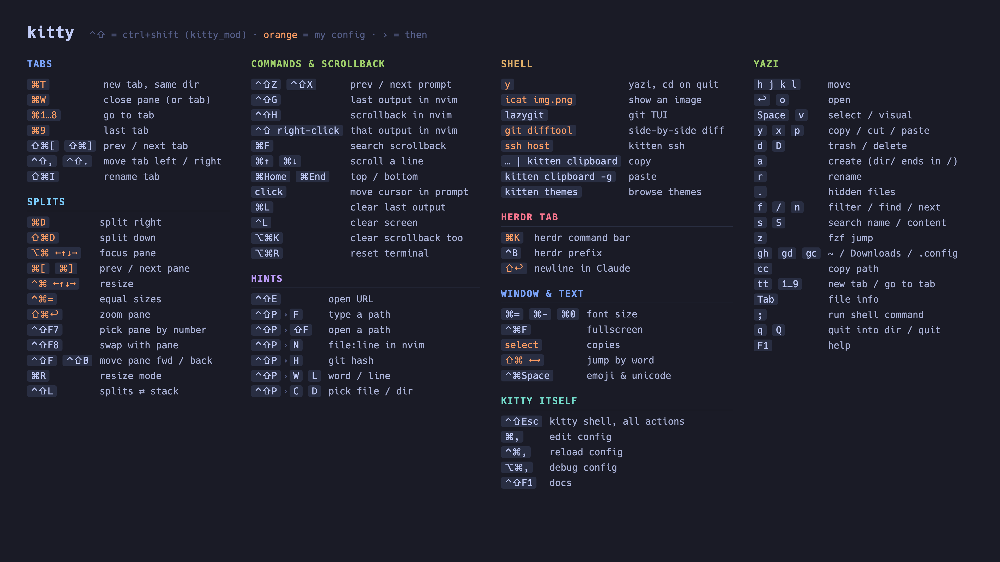

# kitty cheatsheet

My personal [kitty](https://sw.kovidgoyal.net/kitty/) cheatsheet for macOS, in Tokyo Night colors. It covers kitty's defaults plus my own config (Ghostty-style splits and tabs, a herdr tab, yazi, `icat`). Keys in orange are my bindings, not kitty's.



## View it in kitty

Keep it open in its own tab:

```bash
kitten icat --hold --fit=both --scale-up kitty-cheatsheet.png
```

## Edit

The sheet is plain HTML. Edit `cheatsheet.html`, then rebuild the PNG with headless Chrome:

```bash
./render.sh
```

Set `CHROME` to point at another Chromium-based browser if Chrome isn't in `/Applications`.

## Credit

Sections are based on [siekman.io's kitty cheatsheet](https://siekman.io/tools/cheatsheets/kitty). Every binding here was checked against kitty 0.49's defaults and my own `kitty.conf`.
